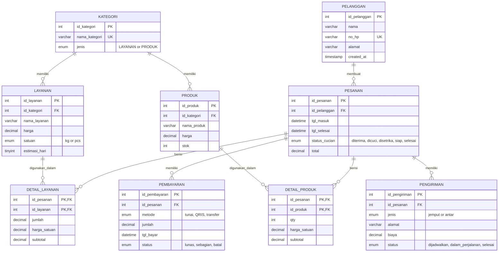

# 📊 Entity Relationship Diagram (ERD)

## Database: laundry_db

### Mermaid ERD



---

## Relasi Antar Tabel

### 1. **PELANGGAN ↔ PESANAN**
- **Tipe**: One-to-Many (1:N)
- **Deskripsi**: Satu pelanggan bisa membuat banyak pesanan
- **Foreign Key**: `pesanan.id_pelanggan` → `pelanggan.id_pelanggan`

### 2. **KATEGORI ↔ LAYANAN**
- **Tipe**: One-to-Many (1:N)
- **Deskripsi**: Satu kategori bisa memiliki banyak layanan
- **Foreign Key**: `layanan.id_kategori` → `kategori.id_kategori`

### 3. **KATEGORI ↔ PRODUK**
- **Tipe**: One-to-Many (1:N)
- **Deskripsi**: Satu kategori bisa memiliki banyak produk
- **Foreign Key**: `produk.id_kategori` → `kategori.id_kategori`

### 4. **PESANAN ↔ LAYANAN** (through DETAIL_LAYANAN)
- **Tipe**: Many-to-Many (M:N)
- **Deskripsi**: Pesanan bisa memiliki banyak layanan, dan layanan bisa ada di banyak pesanan
- **Junction Table**: `detail_layanan`
- **Foreign Keys**: 
  - `detail_layanan.id_pesanan` → `pesanan.id_pesanan`
  - `detail_layanan.id_layanan` → `layanan.id_layanan`

### 5. **PESANAN ↔ PRODUK** (through DETAIL_PRODUK)
- **Tipe**: Many-to-Many (M:N)
- **Deskripsi**: Pesanan bisa memiliki banyak produk, dan produk bisa ada di banyak pesanan
- **Junction Table**: `detail_produk`
- **Foreign Keys**:
  - `detail_produk.id_pesanan` → `pesanan.id_pesanan`
  - `detail_produk.id_produk` → `produk.id_produk`

### 6. **PESANAN ↔ PEMBAYARAN**
- **Tipe**: One-to-Many (1:N)
- **Deskripsi**: Satu pesanan bisa memiliki banyak pembayaran (cicilan)
- **Foreign Key**: `pembayaran.id_pesanan` → `pesanan.id_pesanan`

### 7. **PESANAN ↔ PENGIRIMAN**
- **Tipe**: One-to-Many (1:N)
- **Deskripsi**: Satu pesanan bisa memiliki banyak pengiriman (jemput & antar)
- **Foreign Key**: `pengiriman.id_pesanan` → `pesanan.id_pesanan`

---

## Cardinality Summary

```
PELANGGAN (1) ----< (N) PESANAN
KATEGORI (1) ----< (N) LAYANAN
KATEGORI (1) ----< (N) PRODUK
PESANAN (N) >----< (N) LAYANAN [via DETAIL_LAYANAN]
PESANAN (N) >----< (N) PRODUK [via DETAIL_PRODUK]
PESANAN (1) ----< (N) PEMBAYARAN
PESANAN (1) ----< (N) PENGIRIMAN
```

---

## Entity Details

### Core Entities
1. **PELANGGAN**: Customer master data
2. **KATEGORI**: Categories for services and products
3. **LAYANAN**: Laundry services (cuci, setrika, dll)
4. **PRODUK**: Products for sale (deterjen, pewangi, dll)

### Transaction Entities
5. **PESANAN**: Main order/transaction
6. **DETAIL_LAYANAN**: Order line items for services
7. **DETAIL_PRODUK**: Order line items for products
8. **PEMBAYARAN**: Payments for orders
9. **PENGIRIMAN**: Delivery/pickup for orders

---

## Constraints & Rules

### Foreign Key Constraints
- **ON UPDATE CASCADE**: Changes in parent reflect in child
- **ON DELETE RESTRICT**: Cannot delete parent if child exists (for master data)
- **ON DELETE CASCADE**: Delete child when parent deleted (for transaction details)

### Check Constraints
- `harga > 0`: Price must be positive
- `stok >= 0`: Stock cannot be negative
- `jumlah > 0`: Quantity must be positive
- `estimasi_hari > 0`: Estimation days must be positive

### Unique Constraints
- `pelanggan.no_hp`: Phone number must be unique
- `kategori.nama_kategori`: Category name must be unique

---

## Views

### v_pesanan_belum_lunas
Shows orders with outstanding balance
```sql
SELECT pesanan, pelanggan, total, dibayar, sisa
FROM pesanan JOIN pelanggan
WHERE sisa_tagihan > 0
```

### v_stok_menipis
Shows products with low stock (< 5)
```sql
SELECT produk, kategori, stok
FROM produk JOIN kategori
WHERE stok < 5
```

### v_omzet_bulanan
Shows monthly revenue breakdown
```sql
SELECT bulan, omzet_layanan, omzet_produk, ongkir
GROUP BY bulan
```

---

## How to View This Diagram

### Option 1: GitHub
- Push this file to GitHub
- GitHub will automatically render Mermaid diagrams

### Option 2: VS Code
1. Install extension: "Markdown Preview Mermaid Support"
2. Open this file
3. Press `Ctrl+Shift+V` to preview

### Option 3: Online
- Visit: https://mermaid.live/
- Paste the mermaid code above

### Option 4: Prisma Studio
```bash
npx prisma studio
```
Then click on any table to see its relations interactively.

### Option 5: Database Client
Use tools like:
- **DBeaver** (Free, cross-platform)
- **MySQL Workbench** (Free, MySQL official)
- **phpMyAdmin** (Web-based)
- **TablePlus** (Premium, beautiful UI)

These tools can generate ERD automatically from your database.
