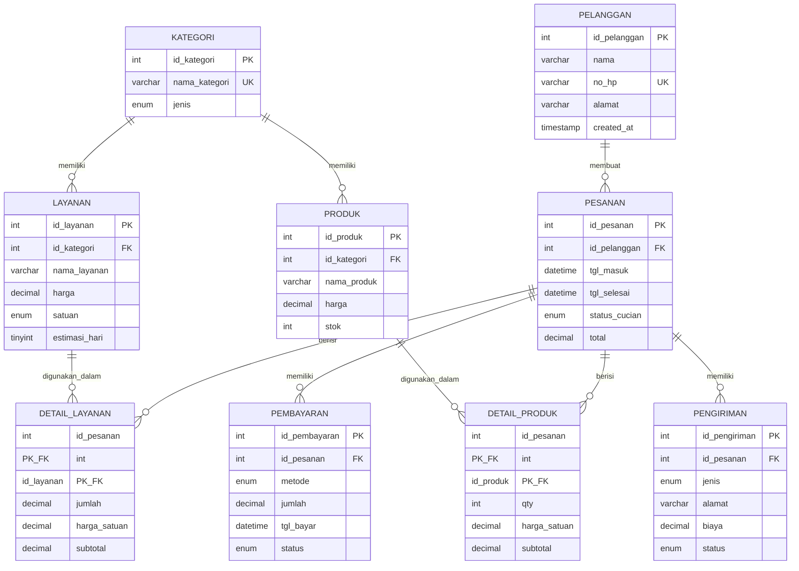

# 🎨 Cara Lihat Diagram ERD

## 🌐 ONLINE (Paling Cepat!)

### Step 1: Copy Mermaid Code
Buka file `ERD.md`, copy bagian ini:

### Step 2: Buka Website
**URL:** https://mermaid.live/

### Step 3: Paste & View
1. Hapus code default di editor
2. Paste code Mermaid Anda
3. Diagram otomatis muncul! 🎨

### Step 4: Export (Opsional)
Klik tombol **"Actions"** → **"PNG"** atau **"SVG"** untuk download

---

## 🖥️ VS CODE (Recommended!)

### Install Extension:
1. `Ctrl+Shift+X` → Search "Markdown Preview Mermaid Support"
2. Install extension
3. Buka `ERD.md`
4. `Ctrl+Shift+V` untuk preview

---

## 🗄️ DATABASE TOOLS

### MySQL Workbench (Free)
**Download:** https://dev.mysql.com/downloads/workbench/

**Cara:**
1. Connect ke database laundry_db
2. Menu: Database → Reverse Engineer
3. Select tables
4. Auto-generate ERD!

### DBeaver (Recommended, Free)
**Download:** https://dbeaver.io/

**Cara:**
1. Connect ke MySQL (localhost:3306)
2. Klik database `laundry_db`
3. Klik tab **"ER Diagram"**
4. Drag tables ke canvas
5. Right-click → Auto-arrange

### HeidiSQL (Lightweight, Free)
**Download:** https://www.heidisql.com/

---

## 🎨 PRISMA STUDIO (Already Running!)

**URL:** http://localhost:5555

**Cara:**
1. Buka Prisma Studio
2. Klik tabel manapun (misal: `pesanan`)
3. Lihat kolom dengan icon 🔗 (ini relasi)
4. Klik untuk navigate ke tabel related

**Keunggulan:** Interactive! Bisa klik dan explore

---

## 📊 ARCHITECTURE DIAGRAM

Untuk visualisasi architecture layers:
- Lihat file `ARCHITECTURE.md`
- Atau buka `APPLICATION_STATUS.md`

